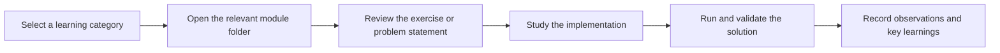

<p align="center">
  
</p>

<h1 align="center">Cognizant Digital Nurture 5.0</h1>

<h3 align="center">Java Full Stack Engineer — Deep Skilling</h3>

<p align="center">
  A structured collection of learning resources, mandatory hands-on exercises, and practical implementations across the Java Full Stack Engineering curriculum.
</p>

<p align="center">
  
  
  
  
</p>

---

## Overview

This repository documents my learning and practical work for the **Cognizant Digital Nurture 5.0 — Java Full Stack Engineer (FSE) Deep Skilling** track.

It is organized around the program's main learning areas and provides a central place to access hands-on exercises, code implementations, reference documents, and supporting learning material.

The curriculum spans software design, algorithms, database programming, Java testing practices, Spring-based backend development, React, version control, DevOps, containerization, cloud fundamentals, and Generative AI.

## Learning Roadmap

```mermaid
flowchart TD
    A["Cognizant Digital Nurture 5.0<br/>Java FSE Deep Skilling"] --> B["Engineering Concepts"]
    A --> C["Programming Languages"]
    A --> D["Products & Frameworks"]
    A --> E["Platforms & GenAI"]
    A --> F["Reference Materials"]

    B --> B1["Module 1: Design Patterns & Principles"]
    B --> B2["Module 2: Data Structures & Algorithms"]

    C --> C1["Module 3: PL/SQL Programming"]
    C --> C2["Module 4: Test-Driven Development & Logging"]

    D --> D1["Modules 5–8: Spring, JPA, Hibernate,<br/>Code Quality & REST"]
    D --> D2["Module 9: Microservices"]
    D --> D3["Module 10: React"]
    D --> D4["Module 11: Application Debugging"]

    E --> E1["Module 12: Git"]
    E --> E2["Module 13: DevOps & CI/CD"]
    E --> E3["Module 14: Docker"]
    E --> E4["Module 15: Agile"]
    E --> E5["Module 16: Cloud Fundamentals"]
    E --> E6["Module 17: GenAI Fundamentals"]

    F --> F1["Handbook & FAQ"]
    F --> F2["Mandatory Hands-on Details"]
    F --> F3["Program Timeline Reference"]
```



## Repository Structure

The top-level structure follows the learning categories used in the repository. The diagram below describes the visible folders and reference files; individual exercise names may vary as the repository evolves.

```text
Cognizant-Digital-Nurture-5.0-Java-Full-Stack-Engineer-Deepskilling/
│
├── Engineering concepts/
│   ├── Module 1 — Design Patterns and Principles
│   └── Module 2 — Data Structures and Algorithms
│
├── Programming Languages/
│   ├── Module 3 — PL/SQL Programming
│   └── Module 4 — Test-Driven Development and Logging
│
├── Products and Frameworks/
│   ├── Module 5  — Spring Core and Maven
│   ├── Module 6  — Spring Data JPA, Spring Boot and Hibernate
│   ├── Module 7  — Code Quality and SonarQube
│   ├── Module 8  — Spring REST using Spring Boot 3
│   ├── Module 9  — Microservices with Spring Boot 3 and Spring Cloud
│   ├── Module 10 — Single Page Application Framework: React
│   └── Module 11 — Application Debugging
│
├── Platforms & GenAI/
│   ├── Module 12 — Version Control: Git
│   ├── Module 13 — DevOps and CI/CD
│   ├── Module 14 — Containerization using Docker
│   ├── Module 15 — Agile Methodology
│   ├── Module 16 — Cloud Fundamentals
│   └── Module 17 — GenAI Fundamentals
│
├── .vscode/
│
├── DN - Java FSE Mandatory hands-on detail.xlsx
├── DN 5.0 - FAQ.pdf
├── DN 5.0-Java FSE-Timelines.jpg
├── DN5.0-Deepskilling-Handbook-Java-FSE-React.pdf
│
└── README.md
```

> **Note:** The module mapping above follows the attached curriculum document and the repository's visible top-level categories. Confirm the actual contents of each category folder before treating this as a complete inventory of every nested exercise.

## Curriculum Modules

### 1. Engineering Concepts

| Module | Topic | Focus |
|---|---|---|
| 1 | Design Patterns and Principles | Reusable software design, maintainability, and design principles |
| 2 | Data Structures and Algorithms | Core data structures, algorithmic problem-solving, and complexity awareness |

### 2. Programming Languages

| Module | Topic | Focus |
|---|---|---|
| 3 | PL/SQL Programming | Database programming, procedural SQL, and data operations |
| 4 | Test Driven Development & Logging Framework | Testing practices, testable code, and application logging |

### 3. Products and Frameworks

| Module | Topic | Focus |
|---|---|---|
| 5 | Spring Core and Maven | Dependency injection, Spring fundamentals, and build management |
| 6 | Spring Data JPA with Spring Boot, Hibernate | Persistence, ORM, and database integration |
| 7 | Code Quality and SonarQube | Static analysis and code-quality practices |
| 8 | Spring REST using Spring Boot 3 | REST API development |
| 9 | Microservices with Spring Boot 3 and Spring Cloud | Distributed services and microservice architecture |
| 10 | Single Page Application framework - React | Component-based frontend development |
| 11 | Application Debugging | Diagnosing and resolving application issues |

### 4. Platforms & GenAI

| Module | Topic | Focus |
|---|---|---|
| 12 | Version Control — Git | Source control and collaborative development workflows |
| 13 | DevOps and CI/CD | Build, integration, and delivery workflows |
| 14 | Containerization using Docker | Packaging and running applications in containers |
| 15 | Agile Methodology | Iterative development and team collaboration |
| 16 | Cloud Fundamentals | Core cloud concepts and services |
| 17 | GenAI Fundamentals | Foundational concepts in generative AI |

## How the Repository Is Organized



Use the category folders to navigate to the relevant topic. The spreadsheet and PDF files provide supporting program references; consult them when checking mandatory hands-on requirements or the intended curriculum scope.

## Technologies and Tools

The curriculum covers the following technologies and engineering practices:

- **Programming and database:** Java, PL/SQL
- **Backend development:** Spring Core, Spring Boot 3, Spring REST, Spring Data JPA, Hibernate, Spring Cloud
- **Frontend development:** React
- **Testing and code quality:** Test-Driven Development, logging, SonarQube
- **Build and delivery:** Maven, Git, DevOps, CI/CD
- **Containerization and cloud:** Docker, Cloud Fundamentals
- **Additional topics:** Data Structures and Algorithms, Design Patterns, Agile Methodology, GenAI Fundamentals

The exact tools required to run an individual exercise depend on that module's implementation.

## Reference Materials

The repository includes the following supporting resources:

| File | Purpose |
|---|---|
| `DN - Java FSE Mandatory hands-on detail.xlsx` | Reference for mandatory hands-on exercises |
| `DN 5.0 - FAQ.pdf` | Frequently asked questions about the program |
| `DN 5.0-Java FSE-Timelines.jpg` | Program timeline reference |
| `DN5.0-Deepskilling-Handbook-Java-FSE-React.pdf` | Deep Skilling handbook for the Java FSE React track |

## Working with the Code

1. Clone or download the repository.
2. Open the folder for the topic you want to study.
3. Read any exercise instructions or accompanying documentation.
4. Install the tools and dependencies required by that exercise.
5. Run the solution using the instructions provided in its folder, where available.
6. Validate the output and document useful observations.

For module-specific setup or execution commands, follow the README or instructions inside the relevant exercise folder if present.

## Repository Goals

- Maintain an organized record of practical learning and hands-on exercises.
- Reinforce concepts through implementation rather than theory alone.
- Make module-wise revision and reference easier.
- Track practical exposure across backend, frontend, database, and engineering tools.
- Keep learning resources and implementation work accessible in one repository.

## Acknowledgement

This repository is maintained for learning and documentation as part of the **Cognizant Digital Nurture 5.0 — Java Full Stack Engineer Deep Skilling** track. Cognizant and the referenced program materials belong to their respective owners.

---

<p align="center">
  <sub>Learning through practice · Building strong full-stack engineering foundations</sub>
</p>
